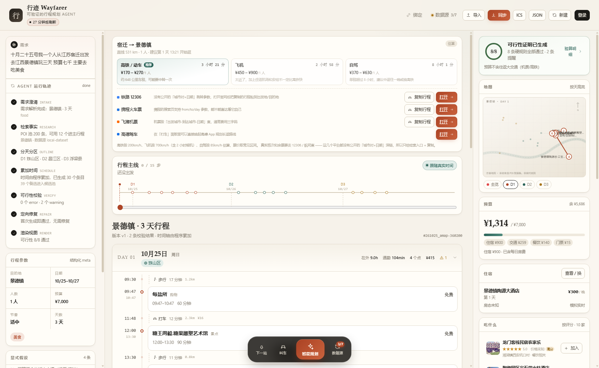
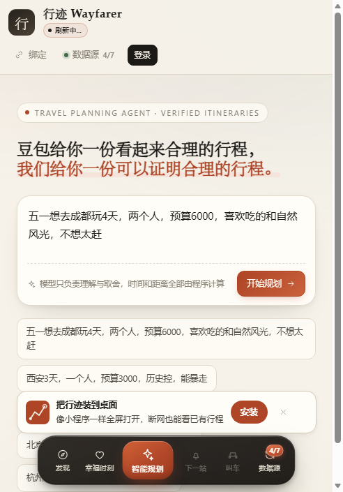
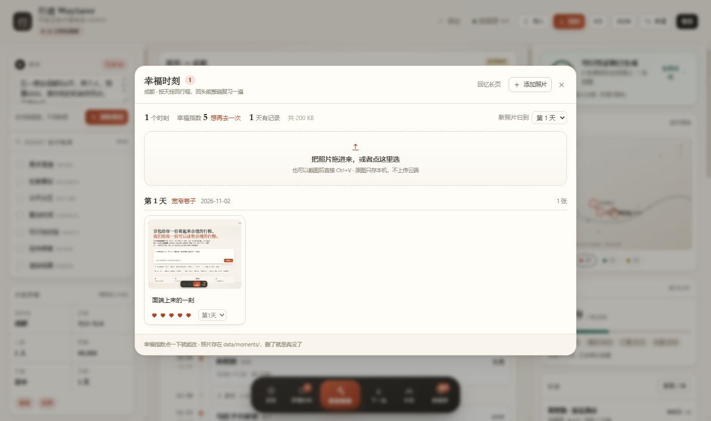

# 行迹 Wayfarer · 可验证的行程规划 Agent

> 豆包给你一份读起来合理的行程，这里给你一份可以逐条验算的行程。

一个本地优先的行程规划 Agent：输入一句自然语言需求，输出**结构化、可编辑、可校验**的行程，
并附带一份能展开看验算过程的**可行性证明**。



## 快速开始

```bash
npm install
npm run crawl    # 先抓一轮（产出 public/catalog.json + official.json）
npm run serve    # http://127.0.0.1:8787  静态站 + 爬虫 API，页面里可一键抓
npm run dev      # http://127.0.0.1:5273  纯前端开发（读同一份 catalog.json）
npm test         # 70 个单测
npm run eval     # 生成 eval-report.md（20 条用例）
npm run build    # 产物在 dist/，同时生成可双击的 dist/standalone.html
```

> 想直接看效果又不想起服务：双击 `dist/standalone.html`。JS/CSS 已内联，
> 最近一次爬虫的 catalog / official / 运行报告也一并注入了，断网也能看到真实跑出来的数据。

**不配任何 Key 也能跑**：天气、景区官网、平台可达性探测、评价导入都不需要授权。
配了高德/百度 Key 之后，景点和酒店的地址、电话、营业时间、评分、实景图才会补上。

## 常驻网页（推荐）

双击 **`start.cmd`**：自动装依赖 → 构建 → 起守护进程 → 等服务就绪 → 打开浏览器。
此后服务一直挂在 `http://127.0.0.1:8787`，**每 30 分钟自动刷新一轮数据**（间隔可用环境变量
`CRAWL_INTERVAL_MIN` 调），顶栏会有一颗「常驻」小标，显示下一轮刷新倒计时。

```text
start.cmd   一键启动（含看门狗，进程挂了自动拉起，1 分钟内连挂 5 次则退避 60s）
stop.cmd    停止服务
logs\server.log   运行日志（超 4MB 自动轮转）
```

想让它**开机自启**（无需管理员）：

```powershell
powershell -ExecutionPolicy Bypass -File scripts\install-autostart.ps1     # 注册登录任务 WayfarerServer
powershell -ExecutionPolicy Bypass -File scripts\uninstall-autostart.ps1   # 撤销
```

原理：登录任务以隐藏窗口运行 `start-hidden.vbs` → `start.cmd` → `scripts/keepalive.mjs`（守护进程，
盯着 `node server/app.mjs`，退出即重启）。定时刷新做在服务进程内部而不是另开一个 crawl:watch，
常驻只占一个进程。

## 需求确认卡：不替你做决定

旧版会自作主张默认「深圳出发」「两周后」，新版一律先问你：

- **出发地 / 出发日期 / 目的地没说清** → 弹「我理解成这样，对吗？」确认卡，
  缺的格子标「待补」，日期格会写明「（推算）」，点任意一格即可改；不想默认的直接留空。
- **信息说全了**（像「十月二十五号我一个人从江苏宿迁出发 去江西景德镇玩三天 预算七千」）
  → 不打扰，直接开排。
- **目的地不在内置 5 城里** → 不再让你从五个城市里挑，而是用高德现场建一份「城市包」
  （约 200 个景点/餐馆/咖啡馆/商场，带实景图，落盘缓存 24 小时），景德镇、婺源这类小城都能排。

## 城际交通：同步到各种出行软件

出发地与目的地不同城时，行程顶部出现「宿迁 → 景德镇」交通卡，按铁路 200km/h+0.7h、
飞机 700km/h+2.2h、自驾 85km/h 估算三种方式的耗时与票价区间，并给出直达链接：

| 平台 | 跳转 |
|---|---|
| 铁路 12306 | `kyfw.12306.cn/otn/leftTicket/init`（车次/日期预填说明） |
| 携程火车票 | `trains.ctrip.com`（from/to/day 参数预填） |
| 飞猪 | `sh.flight.fliggy.com`（机票） |
| 高德地图 | 驾车路线（起终点坐标预填） |

「复制行程」把行程摘要放剪贴板，粘到任何 App 里都能用。

## 吃什么：餐饮推荐

右栏「吃什么」面板按评分列出城市包里的高分餐馆 / 咖啡馆（人均、评分、缩略图），
点「加入」直接插进当前天的时间轴并重算通勤。网红店 / 宝藏店铺靠高德的「人气榜单」
类目与评分 ≥ 4.6 的「高分」标记呈现，不靠编。

## 它到底在做什么

```
INTAKE   解析需求，缺目的地就停下来问
   ↓
OUTLINE  按地理聚类分天，>30km 的郊县点下沉到候选池
   ↓
SCHEDULE 程序累加时间（模型不碰任何数字）
   ↓
VERIFY   8 条确定性规则 → violations + 可行性凭证
   ↓
REPAIR   最多 3 轮定向修复，无改善即停，必要时降级
   ↓
RENDER   时间轴 / 地图 / 凭证 / 候选池 / What-if
```

## 三个不能破的红线

1. **模型不算时间。** 时间轴由 `schedule.ts` 逐段累加，所以「11:00 结束、10:30 开始」在结构上不可能出现。
2. **POI 必须能反查。** 每个条目带 `poi_id`，查不到就删，不编造。
3. **未知不等于通过。** 没有营业时间数据的条目记入 `covered=0`，凭证上明写「未覆盖」，不计入通过率。

## 8 条规则

| code | 检查 | 级别 |
|---|---|---|
| `TIME_OVERLAP` | 时间连续（含通勤条目） | error |
| `OUTSIDE_OPENING` | 营业时间 / 闭馆日（支持跨零点） | error |
| `GEO_SCATTER` | 单日跨度与通勤总量（>50km 升级为 error） | warning / error |
| `BUDGET_EXCEEDED` | 总花费（含住宿）不超预算 | error |
| `OVER_PACE` | 每日时长与景点数不超档位 | warning |
| `BOOKING_RISK` | 需预约项提示 | info |
| `WEATHER_CONFLICT` | 恶劣天气 × 户外项目（需显式注入天气） | warning |
| `TRANSIT_UNREACHABLE` | 单段通勤不超 120min / 60km | warning |

## 界面

- **左栏**：Agent 运行轨迹（7 个阶段）、解析出的 meta、修复记录、显式假设
- **中栏**：**行程主线** + 按天的时间轴。主线是一条贯穿全程的线，节点按真实时间比例排布，
  可以拖动「旅程时钟」看到自己走到第几步、正在哪一站；卡片可拖拽排序、锁定、替换、删除
- **右栏**：可行性证明（可展开逐条验算）、按天高亮的地图、预算构成、住宿（实时房态）、候选池、What-if 模拟器

任一改动都会重跑该天的 `reflow`（重算通勤与时间）与全量校验，凭证同步更新。

## 景点详情页

点时间轴上的任意站名进入。左侧是「此刻 / 你的安排 / 问 Agent / 评论区」：

- **此刻**：人流、排队时长、今日票价（本地确定性模拟，界面上明确标注数据源）
- **你的安排**：到达方式、下一站、命中规则；可改停留时长与备注，保存后当天时间轴重排
- **问 Agent**：输入「换一个」「晚点去」「缩短到 60 分钟」「换成室内的」「换到第 2 天」「删掉」，
  只改这一站并重跑校验，回复里会带上当前可行性。换不掉的会直说（例如周一博物馆闭馆）
- **评论区**：评分 + 文字，示例评论本地生成，自己的评论存 localStorage

## 风景图

详情页顶部是宽幅图：**抓到实景图就显示实景**（高德 Key 生效时），抓不到才退回插画。
下方另有「清晨 / 傍晚 / 夜景」三张同一点位的插画。

插画是**程序化生成的 SVG**，不是照片：

- 按 `poi_id` 做种子，同一景点每次打开都是同一张图，不同景点构图不同；
- 构图按类型分 9 种：山峦 / 水域 / 老街 / 博物馆 / 城市夜景 / 小吃街 / 公园 / 塔寺 / 酒店；
- 不依赖任何外链图片，离线、断网、单文件打开都不会破图。

> 为什么不直接放网图：没有图片来源授权，外链也会失效。实景图走的是高德 API 返回的
> `photos[].url`，带「高德地图用户实景图」署名；没有 Key 时不编图片，用插画并在图上标「示意图」。

## 内置爬虫

不是"接了个接口"，是真的在抓：读 robots、限速、重试、条件请求、统计请求数和字节数。

```bash
npm run serve        # 本地服务：静态站点 + /api/crawl 一键抓取（推荐）
npm run crawl        # 命令行抓一轮
npm run crawl:watch  # 常驻，每 30 分钟一轮
npm run crawl -- --only=weather,gov     # 只跑某几个源
npm run crawl -- --offline              # 不联网，只出内置快照
```

产物三份：`public/catalog.json`（事实层）、`public/official.json`（官方公告）、
`public/crawl-report.json`（每个源的状态/请求数/耗时/日志）。

### 六个源，各自能拿到什么

| 源 | 要 Key | 真实产出 | 说明 |
|---|---|---|---|
| 景区官网 / 文旅局 | 否 | 武侯祠、金沙、故宫的**官方简介 + 票价/开放时间/公告** | 已登记 4 个确认过的官网；市级文旅局多数是 SPA 或有反爬（成都 412），失败原因会如实记录 |
| 中国天气网 / 天气网 | 否 | **5 城实况 + 七天预报** | 用浏览器正常访问就有的公开页面，不伪装客户端 |
| 高德开放平台 | **是** | 地址 / 电话 / 营业时间 / 评分 / **实景图** | 免费 Key；实测 89/100 命中，291 张实景图 |
| 百度地图开放平台 | **是** | 综合评分 / 评论数 / 标签 | 免费 AK |
| **智谱 GLM 联网检索** | **是** | 开放时间 / 票价 / 简介 / 酒店地址电话 | 给没官网、没地图 Key 的点位补数据；两段式 + 逐字证据校验 |
| 点评平台探测 | 否 | 携程 / 点评 / 马蜂窝 / 小红书的**真实可达状态** | 每轮每平台 1 个请求，只握手不采集 |
| 评价导入 `data/inbox` | 否 | 你合法导出的平台评价正文 | JSON / CSV，见 `data/inbox/README.md` |

### 高德：怎么保证不抓错地方

配了 Key 之后，`place/text` 一次返回地址、电话、营业时间、评分、实景图。
难点不在调接口，在**名字对不上时怎么办** —— 100 个点位里有 28 个搜出来的第一个结果不是它。

规则是三层，越往后越保守：

1. **同名或包含**（长度差 ≤ 2）：如「宽窄巷子」→「宽窄巷子景区」；
2. **公共片段够长**：≥3 个字（「小酒馆」「君悦酒店」），或公共段等于较短名字的全部（「西湖」被完整包含）；
3. **都不满足就不写**，日志里留一行「高德只返回 X，与它无关，不采用」。

第 2 条一开始放得太松（≥2 个字就算），结果「龙井·茶园民宿」被认成「西湖栖岸民宿」、
「湖滨·青旅床位」被认成「旅小二青旅酒店」—— 靠「民宿」「青旅」这种泛词撞上的都不是同一个地方。
收紧之后 100 个点位命中 89 个，剩下 11 个宁可不写。

还有一条**撤回机制**：某个源这轮判定「不是我」，会把上一轮自己写过的字段删掉
（只删自己的，官网/导入/内置的不动）。起因是「演武大桥观景台」被错写成「南普陀寺」的地址电话，
规则收紧后新数据不写了，但上一轮的错数据还留在 catalog 里——现在会一起清掉。

### 关于「各平台评价」

能拿到什么、拿不到什么，界面上逐个标了：

- **高德 / 百度**：`需 Key`。配 Key 后有评分、点评数、标签、实景图 —— 但没有正文，两家都没开放正文接口。
- **携程 / 大众点评**：`无正文`。公开页能打开（HTTP 200），但评分和点评是客户端异步渲染的，
  服务端 HTML 里根本没有；正文抓取违反服务条款，不做。
- **马蜂窝 / 小红书**：`被拒`。robots.txt 明确禁止，直接放弃，不绕。
- **本机评价**：`已接入`。你自己写的那些。

要正文，只有两条合法路径：平台授权，或商家后台导出 → 放进 `data/inbox/`。
`server/sources/inbox.ts` 会把它归一化成和 API 一样的结构，界面上看不出差别，但会标来源文件。

### 智谱 GLM：先想再答，两轮互证

先把 Key 配进去（`server/.keys.json` 的 `glm`，或界面「数据源 → Key 配置 → 测试」）。
每轮抓取会挑 N 个点位（默认 10 个，`GLM_MAX` 可调，游标轮换，跑几轮把 84 个点位轮完）：

1. **先思考**：让模型凭自己的知识把开放时间 / 票价 / 简介说一遍，每条自己标【确定】或【不确定】，
   纯文本，不给 JSON 格式 —— 一边组织格式一边写数字，它就开始编；
2. **整理成 JSON**：把它刚说的笔记收成结构化字段，不许新增笔记里没有的事实；
3. **独立复核**：换一段完全不带前文的提问，让它再答一次，看不到第 2 轮的结果。

**全部走 chat completions，按 token 计费，不碰 `web_search`。** 联网检索是独立计价的
（`search_std` 0.01 元/次），一趟全量几十次，账单一涨就没人敢点了。

为什么不一次搞定 —— 这是实测踩出来的：同一轮里既要 JSON 又要联网时，模型在「搜索结果为空」
的情况下会**直接用记忆编**（西安钟楼被写成门票 0 元，实际 30 元）。

没有网页片段之后，就没法再做逐字校验了，替代方案是**两个通道互相当证据**：

- 硬字段（`hours` / `price` / `phone` / `address`）必须第 2、3 轮**完全一致**才写入，
  时间先归一成 `HH:MM` 再比，电话只比数字；
- `intro` 不涉及数字，取第 2 轮，但要求模型自己标了「确定」且给出了依据类型；
- 对不上就整条丢弃，日志写明「两轮答案对不上（或模型自己说不确定），未写入」。

编出来的数字两轮几乎不可能一样；真记得的东西会稳定复现。这是拿 token 换可信度 ——
单次成本比检索低一个数量级，多花一轮完全划算。

另外两条硬规则：

- **人工核实过的数据不被覆盖**：内置数据集里 `hours_confidence: verified` 的点位，
  其开放时间标记为 `seed-verified`（优先级 28），高于 GLM（25）。
  这一条是西湖教的 —— 攻略站把「全天开放」写成 07:00–18:30。
- **来源标注说实话**：GLM 写进去的字段没有链接可点（本来就没有网页），
  界面上一律显示「智谱 GLM·模型记忆」，不伪装成官网口径。

定点刷新某几个点位：

```bash
GLM_IDS=BJ01,CD02 npm run crawl -- --only=glm
```

只想看看它现在会写什么（不落盘，只打印），用冒烟脚本：

```bash
npx esbuild scripts/glm-smoke.ts --bundle --platform=node --format=esm \
  --outfile=scripts/glm-smoke.mjs --log-level=warning
GLM_DEBUG=1 NAMES=东郊记忆 node scripts/glm-smoke.mjs   # GLM_DEBUG=1 打印两轮原始 JSON
```

### Key 放哪

```bash
AMAP_KEY=xxx BAIDU_KEY=yyy GLM_KEY=zzz npm run crawl     # 环境变量，优先
# 或写 server/.keys.json（页面上「数据源 → Key 配置」也能填，带「测试」按钮）
```

Key 只在 Node 侧用，不进页面、不进构建产物。前端只会拿到 `abcd…xy` 这种掩码。

## 出发提醒：到点前主动喊你

行程进行中（当天），**下一站出发前 30 分钟**会出现提醒条，回答三件事：

- **下一站是哪、几点该出发**：活动开始时间 − 前一段通勤时长，由程序算
- **怎么去最合适**：按距离给建议（<0.9km 步行、1–3km 公交或打车、>3km 打车并附车费估计），
  并标出「原计划步行/地铁」供对比
- **直接走**：`高德导航`（起终点带名字，`uri.amap.com` 深链）、`叫车`（弹出六平台打车面板）、`看这一站`

提醒条同时会在授权了通知的浏览器上弹**系统通知**（每个点位只弹一次）。
拖动「旅程时钟」滑杆也会触发同一条提醒 —— 不用等到真出行那天才能看到效果。

## 表达推算：说错了会提醒你

用户的话解析完之后，还有一道「表达审查」，分两层：

| 层 | 检查什么 | 怎么判 |
|---|---|---|
| 本地确定性规则 | 预算量级（人均每天 <¥80 或 >¥2万）、指代不明（「那边」「那里」） | 程序直接算，零误报 |
| 智谱 GLM | 地名混淆（宿州/宿迁、泰山是市还是山） | 模型只出 suspect，quote 必须逐字出现在原话里才收 |

报出来的问题只**提醒**，不替用户改：每条都是「原话片段 → 为什么可能跑偏 → 建议怎么澄清」，
在确认卡里内嵌显示，或行程上方挂一条可关闭的提醒条（带「重新描述一下」按钮）。
没配 GLM Key 时本地检查照常工作。

## 行程全览图

右栏地图有两个模式：**日视图**（原有，浅色，当前天的序号点 + 通勤线）和
**全览**（暗色底图，深灰经纬网，整趟行程每一站都是红色光点，路线串成一条线，
当前位置是带光晕的大头针，左上角徽章显示「N 个行程地点」）。
点图例「全览」切换，手机上同样可用。

## 手机端

390px 宽（iPhone 尺寸）完整可用：三栏自动折叠为单列，顶栏按钮横向滚动，
确认卡变两列网格，提醒条纵向堆叠，打车面板/详情页/时间轴均已适配。
`scripts/smoke-mobile.py` 用 390×844 视口跑完整流程并截图（`shots/mobile-*.png`）。

## 装成手机 App（PWA）

手机浏览器打开后，底部会出一条「把行迹装到桌面」的引导：

- Android / 桌面 Chrome：直接点「安装」，系统弹原生安装框；
- iOS Safari：没有安装 API，按提示走「分享 → 添加到主屏幕」。

装完是一个独立图标，点开全屏无地址栏，断网也能看已拉取的行程（壳与静态资源有缓存，
`/api/*` 永远走网络不缓存，所以数据不会陈旧）。



实现：`public/manifest.webmanifest`（standalone + 主题色米白）+ `public/sw.js`
（导航 network-first / 哈希资源 cache-first / 其余 stale-while-revalidate）+
`src/components/InstallBanner.tsx`（关闭一次就记住，不再打扰）。
图标是 `scripts/make-icons.mjs` 用 SDF 手绘 PNG 生成的——陶土红底、米白行程折线、
终点一个定位环，零依赖可重新生成。

注意：Service Worker 需要 HTTPS 或 localhost。本机 127.0.0.1 直接可用；
手机上使用需配公网隧道（见下方「固定网址」计划）。

## 天气实时提醒

行程页顶部有一条天气带：实况（温度/天气/湿度/风）、未来 4 天预报，以及**能直接执行的提醒**。

提醒不是把 68% 丢给用户，而是说清楚"哪天、哪几站在户外、可以怎么办"：

> 第 1 天 小雨 · 降水概率约 68%
> 钟楼、鼓楼、西安城墙（永宁门） 在户外。可以把其中一站换成室内备选，或整体顺延到雨停之后。
> 　[换成室内]　[看这一站]

- `[换成室内]` 走单站重规划，只改这一站并重跑 8 条校验
- `[提醒我]` 申请浏览器通知权限，出发当天有雨时弹系统通知
- 行程日期超出七天预报时，会直说「预报只到 10/24，出发前 3 天再看」——
  **不拿今天的天气去推断两周后**
- 降水概率是按天气现象映射的估计值，界面上写明了，不是数值预报

## 打车跳转

详情页右上角「打车」打开面板，六个平台：

| 平台 | 唤起 | 说明 |
|---|---|---|
| 高德打车 | `amapuri://route/plan/` | 官方 URI API，带终点坐标与名称 |
| 百度地图 | `baidumap://map/direction` | 已标 `coord_type=gcj02`，不会把终点算偏 |
| 腾讯地图 | `qqmap://map/routeplan` | 腾讯位置服务 URI API |
| 滴滴出行 | `diditaxi://` | 只唤起 App（没有公开的目的地协议），配合「复制目的地」 |
| 曹操 / T3 | 无 | 没有公开唤起协议，只给官网 + 复制，不编假的 scheme |

唤起 1.2 秒后如果页面还在前台（说明没装 App），自动回落到网页版。
直线距离不到 1.2 公里时会提示「走过去可能更快」。

## 登录与绑定

- **登录**：验证码 / 密码 / 注册三种方式，另有「本机访客」。账号存在 localStorage，密码做 SHA-256 摘要，不上传。
- **绑定行程软件**：铁路 12306、高德地图、携程、飞猪、航旅纵横、系统日历。
  点「去绑定」会走一遍授权界面（授权码 / 手机号），绑定后可「同步一次」或解绑。

> **12306 没有公开的数据接口。** 任何「自动读取你的车票」的做法都违反服务条款，所以这里做的是
> 授权式绑定的界面与状态机，不抓取、不登录你的账号。真实上线应接官方开放平台，由用户主动授权。

## 住宿

右栏「住宿」卡片显示当前酒店与实时房态，点开可以看同城的 3–4 个备选（价格 / 评分 / 距首站距离），
换酒店会重算每晚房费与次日出发时间。

## 幸福时刻

底部 Dock 的「回忆」按钮。把这次旅行拍的照片拖进来，它们会**按天挂回行程**：
每张图都要回答「第几天拍的」「当时有多开心」（1–5 颗心），再配一句话 ——
它的用途是把这一趟复习一遍，不是又一个图床。

- **只存本机**：照片落在 `data/moments/`，一份 `index.json` 记元数据，不传任何云端
- 上传前先压缩到长边 1600、质量 0.82（手机原图能压到几百 KB，肉眼无差）；截图可以直接 Ctrl+V
- 大图里可以标「当时在」哪个点位，标完时间轴上那一项会出现红心角标
- 「回忆长页」一键生成一封按天分段的信，`Ctrl+P` 存成 PDF 就能发给同行的人



## 同步到日历 / 分享

顶部「同步」有三种方式，都不需要登录：

| 方式 | 产物 | 适用 |
|---|---|---|
| 日历 | `.ics`（每条带提前 30 分钟提醒） | Google 日历 / Apple 日历 / Outlook 导入 |
| 分享链接 | `#plan=` 后接 deflate-raw + base64url 的整份行程 | 发给别人，打开就是可交互行程 |
| 纯文本 | Markdown 风格的行程清单 | 微信 / 备忘录 |

## 目录

```
src/
├── domain/      schema(Zod) / time / geo / summary / live / palette / alerts / taxi / intercity
├── verifier/    rules.ts（8 条纯函数）+ index.ts（凭证构造）
├── agent/       intake / research / outline / schedule / repair / reflow / whatif / importer / orchestrator / llm
├── providers/   weather.ts（模拟，可替换为 Open-Meteo）
├── data/        pois.ts（5 城内置 + 动态城市包注册）/ hotels.ts / comments.ts / official.ts /
│                bindings.ts / catalog.ts（爬虫产物契约 + 平台登记表）/ citypack.ts（客户端城市包）
├── hooks/       useCatalog（server / static / seed 三态降级）/ useOfficialFeed / useResident（常驻状态）
├── auth.ts      本机账号（SHA-256 摘要）
└── components/  MomentsWall（幸福时刻）/ IntakeConsole / Timeline / RouteRibbon / MapView / Certificate /
                 RightRail / PoiDetail / SceneryArt / CommentSection /
                 HotelModal / SyncModal / ImportModal / LoginModal / BindingsModal /
                 DataSourcesModal / ReviewBoard / WeatherAlertBar / TaxiSheet /
                 RequirementsCard / IntercityCard / FoodPanel / ErrorBoundary

server/          crawler.ts（调度）/ app.ts（本地服务 + 爬虫 API + 30 分钟定时刷新）
                 net.ts（robots·限速·重试·ETag）
                 merge.ts（多源合并，按来源优先级裁决）
                 sources/  gov / weather / amap / baidu / platforms / inbox / citypack（城市包生成）
data/city-packs/ 动态城市包缓存（24h）
scripts/         eval.ts（评测）、smoke-plan.py（端到端冒烟）、keepalive.mjs（进程守护）
                 install-autostart.ps1 / uninstall-autostart.ps1（开机自启）
start.cmd / stop.cmd / start-hidden.vbs    常驻一键启停
docs/            plan-v3.md（规划书 v3.0 源文件）
```

## 可选：接入 GLM

右上角「接入模型」填入智谱 API Key（只存本机 localStorage）。接入后**只有 INTAKE 阶段**走模型，
把口语需求抽成 `meta`；其余阶段仍是确定性计算。请求失败会自动回退到规则解析。

> 为什么不把 OUTLINE / REPAIR 也交给模型：这两步的输入输出都是结构化的，规则版更稳、更快、可单测。
> 模型的价值在「理解需求」，不在「做算术」。

## 已知边界

- 地图是示意图（经纬度投影 + 连线），不是真实底图；接高德 JS API 后可替换 `MapView`。
- 通勤时间按直线距离 × 1.32 绕路系数估算，非实时路况。
- 营业时间部分为估算（`confidence: estimated`），凭证里会区分「已知 / 未知」。
- 天气：只有七天预报，行程在七天之外时明说看不到；降水概率是按天气现象映射的估计值。
- 评价：携程/点评/马蜂窝/小红书没有公开接口，**不抓正文**；高德/百度只给评分与条数。
  要正文只能走授权或商家导出（`data/inbox/`）。
- 爬虫覆盖：景区官网只登记了 4 个确认过的（武侯祠/金沙/熊猫基地/故宫）；市级文旅局多数是 SPA 或有反爬。
- GLM 抽的是公开网页，**第三方攻略站会滞后**（票价、淡旺季时间尤其）。所以每条都带链接，
  界面上点得回去；重要数据仍以官网/地图 API 为准。
- 打车：只用了三家地图的官方 URI API；滴滴只有 `diditaxi://`；曹操/T3 没有公开协议，只给官网。
- 高德实景图是高德用户上传的（`store.is.autonavi.com`），署名标在图上；商用需按高德条款处理。
- 高德免费配额有限：个人开发者 POI 搜索约 3 QPS、有日上限，100 个点位一轮约 40 秒。
- What-if 的「暴雨」是显式假设，不是预报；真实预报走顶部的天气提醒条。
- 「实时」人流 / 排队 / 房态都是本地模拟：同一时刻结果稳定，随时间轻微变化，界面上标了「模拟实时」。
- 评论是本地示例数据 + 自己的留言，没有后端，不同设备之间不互通。
- 风景图是程序化插画，用来保证每个点位都有图且不破图；不是实拍，详情页上有明确标注。
- 官网抓取只覆盖文旅局/景区官网的公开公告页；12306 等无公开接口的平台不抓，只做授权绑定界面。
- 持久化用 localStorage，刷新不丢，但不能多设备同步。

## 评测

`npm run eval` 会跑 20 条用例（完整 / 残缺 / 冲突 / 修改 / 对抗 五组），输出 `eval-report.md`。

当前结果：通过率 100%，首次通过率 95%，POI 有效率 100%，70 个单测全绿。
